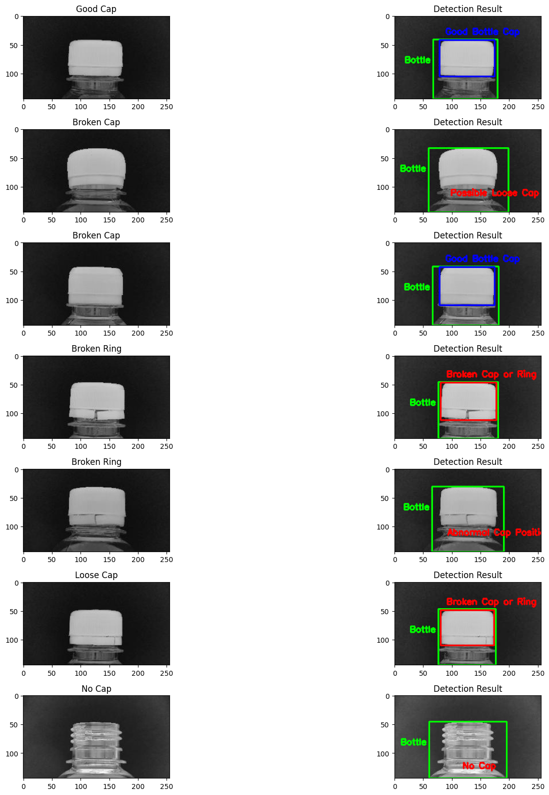

# Bottle Cap Defect Detection

University coursework: automatic visual inspection of bottle caps using **classical computer vision**, with no model training. Each bottle is classified as **Good Cap**, **No Cap**, **Loose Cap** or **Broken Cap / Ring**.

📓 **Notebook:** [`bottle-cap-detection.ipynb`](bottle-cap-detection.ipynb)

<p align="center"></p>

## Approach
The pipeline is hand-crafted with **OpenCV** and **scikit-image**:
1. **Pre-processing:** gamma correction to improve contrast, then conversion to HSV.
2. **Segmentation:** HSV thresholds isolate the cap and the bottle's bottom area. Erosion and morphological closing separate the cap from the ring.
3. **Localisation:** connected-component analysis (`regionprops`) finds the cap region, its orientation and its bounding-box corners, as well as the bottle-neck area below it.
4. **Rules:**
   - no large cap region → **No Cap**;
   - cap orientation not level → *abnormal cap position*, counted as **Broken Cap / Ring**;
   - any **Canny** edges inside the cap region (cracks) → **Broken Cap / Ring**, otherwise → **Good Cap**;
   - a vertical gap of more than 20 px between the cap's bottom corners and the bottle-neck area → **Loose Cap**.
5. **Evaluation:** the rules are applied to every test image and compared with the labels in a classification report.

## Results (test split, 124 labelled boxes on 112 images)

| Class | Precision | Recall | F1 |
|---|---|---|---|
| Good Cap | 0.78 | 0.78 | 0.78 |
| No Cap | 1.00 | 1.00 | 1.00 |
| Loose Cap | 0.71 | 0.59 | 0.64 |
| Broken Cap or Ring | 0.63 | 0.76 | 0.69 |
| **Overall** | | | **accuracy 0.73 · macro-F1 0.78** |

Missing caps are detected perfectly. Loose caps are the hardest class, because a small shift in cap height is easy to confuse with normal variation.

## Data
Webcam images (256 × 144 px) with bounding-box labels, exported from Roboflow.
- **Included:** the **train split** in [`data/train/`](data/train): 398 images and 423 labelled boxes (Good Cap 152, No Cap 112, Loose Cap 89, Broken Cap 35, Broken Ring 35).
- **Included:** the **validation split** in [`data/valid/`](data/valid): 113 images and 119 labelled boxes (Good Cap 43, No Cap 32, Loose Cap 23, Broken Cap 13, Broken Ring 8). The notebook loads it and shows a sample detection from it.
- **Included:** the **test split** in [`data/test/`](data/test): 112 images and 124 labelled boxes (Loose Cap 46, Good Cap 23, Broken Ring 23, No Cap 17, Broken Cap 15). Some images have more than one box. The evaluation scores every labelled box, so it has 124 rows.

## How to run
```bash
pip install -r requirements.txt
jupyter notebook bottle-cap-detection.ipynb
```
Run All runs the whole notebook, using all three splits, from data loading and the segmentation steps to the full test-set evaluation. It reproduces the results above exactly (checked with OpenCV 5.0, scikit-image 0.26 and scikit-learn 1.9).

## More projects
- [Multi-class Fraud Type Classification](https://github.com/Hapi1177/fraud-type-classification): end-to-end ML project on 1M transactions
- [Adult Income Prediction](https://github.com/Hapi1177/adult-income-prediction)
- [Steel Industry Energy Usage Prediction](https://github.com/Hapi1177/steel-energy-usage-prediction)
- [AI Tutor with GPT API](https://github.com/Hapi1177/ai-tutor-gpt-api)
